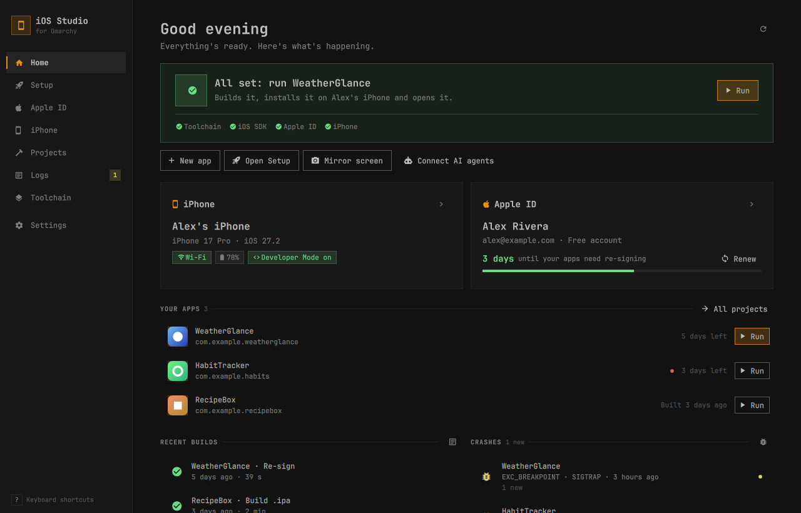
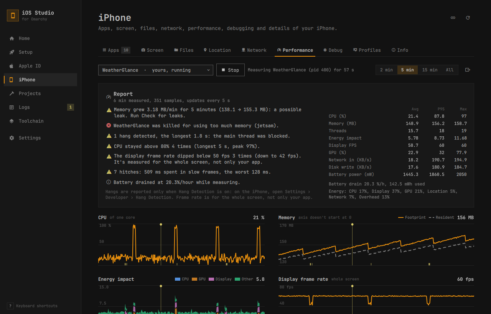

# iOS Studio

[](https://github.com/ArtMin96/omarchy-ios-studio/actions/workflows/ci.yml)

Build iPhone apps on Omarchy Linux and run them on your own iPhone, without a Mac.



iOS Studio is a desktop app for [Omarchy](https://omarchy.org/). It installs the iOS toolchain, signs you in to your Apple ID, pairs your iPhone and builds your apps. After the install command below, you can do everything from the app window. It uses your Omarchy theme and font and changes with them.

## What it does

| Page | What you do there |
|---|---|
| Home | See your next step, what's ready, your iPhone, how many days until apps need re-signing, your apps with Run, and recent builds and crashes. |
| Setup | Install Swift, xtool, the iOS SDK and the iPhone tools with one button. |
| Apple ID | Sign in and see your team, certificates, profiles and the free-account limits. |
| iPhone | Pair your phone and work with it: see the list below. |
| Projects | Create an app from a template, build it, run it on your iPhone and re-sign it. New apps come with `AGENTS.md` and `CLAUDE.md`, so coding agents build through iOS Studio instead of looking for Xcode. A failed build lists each problem with its file and line, or with a hint when the problem is outside your code. Watch mode (in the Run button's menu) compiles on every save, so errors show up in Problems a few seconds after you stop typing (optionally running the app after each clean build); the card and the sidebar show how the last compile went. Hot reload (a switch on the project card) puts the Swift code you save into the app already running on your iPhone a couple of seconds later, without a new build and install, which is the closest thing to SwiftUI previews on Linux; a change it can't swap in, such as a new type or stored property, is refused with the reason and a Run again button. Each project card warns about settings mistakes before you build: misspelled `xtool.yml` keys, a missing camera or location permission text in `Info.plist`, a bad icon, entitlements a free Apple ID can't use. Format project (in the card's ⋮ menu) shows swift-format's changes as a diff before writing them, using the project's `.swift-format`, and Lint project puts style warnings from swift-format (and SwiftLint, if installed) in Problems with their file and line, apart from the build's own problems and hideable. Debug in editor attaches VS Code's or Zed's debugger to the app on your iPhone: press F5 in the editor, and breakpoints stop the app with its stack and variables. Set icon… makes the app icon from any picture: it shows how it looks on the Home Screen, then saves a 1024×1024 PNG without transparency and sets `iconPath` in `xtool.yml`. Packages… lists a project's Swift packages and adds one by its Git URL (fetched and linked to the app, then a compile-only Check build), updates them or removes one after showing the change to `Package.swift`. Run presets save launch arguments, environment variables and an app language per project, so Run can open the app in German or with a debug flag; the Run button's menu picks one. Projects that build through their own scripts get build settings: a prebuild command, environment variables, an open-file limit and permission to build a generated `xtool.yml`. |
| Logs | Read your iPhone's live log, see what your app prints (`print()`), open crash reports with the file and line your app crashed on, and look back at build logs. |
| Toolchain | Check versions and disk usage, free space, repair or remove everything. |
| Settings | Project folders, your editor and Swift completion for it (Zed, Neovim with LazyVim, VS Code: set up in one click), notifications, automatic re-signing, AI agents (and whether new apps get agent instructions), a launcher shortcut, tiled or floating, opaque window. |

On the iPhone page you can:

- manage installed apps and fake the phone's location
- watch the screen live, take screenshots and record short videos for bug reports
- save a screenshot as a screen's baseline and compare later ones with it, with the changes highlighted (iPhone › Screen › Compare: baseline, current and diff side by side)
- read the app on the screen as a list of buttons and texts, press them on the phone, and run Apple's accessibility audit
- import photos and videos from the camera roll, and feed camera code test images
- open an app for its details: browse and change its files, look inside what your own apps saved (UserDefaults, SwiftData and Core Data stores), edit a default, and reset an app to its first launch (iPhone › Apps › the app: Defaults, Stores, Reset and Files)
- make the phone act as if it's on a slow network, running hot or with a slow GPU, and record an app's traffic over USB
- measure an app's CPU, memory, energy and frame rate, with a report of anything unusual
- capture a backtrace or stop at breakpoints in your own apps with LLDB



Press `?` in the app to see the keyboard shortcuts.

## What Linux can't do

- There is no iOS Simulator on Linux, so your apps run on a real iPhone.
- The iOS SDK only comes inside Apple's Xcode download. You download it once in your browser with your Apple Account (a free one works), and iOS Studio does the rest.
- A free Apple ID signs apps for 7 days and allows 3 of your apps on a phone at a time. TestFlight and the App Store need a paid Apple Developer Program membership.

## Install

You need Omarchy. Open a terminal (Super + Return) and paste:

```bash
git clone https://github.com/ArtMin96/omarchy-ios-studio ~/.local/share/omarchy-ios-studio && ~/.local/share/omarchy-ios-studio/install.sh
```

Then open iOS Studio from the app launcher. The Setup page takes it from there.

That installs the newest code on `main`. To install a [release](https://github.com/ArtMin96/omarchy-ios-studio/releases) instead, clone its tag (here v0.2.0):

```bash
git clone --branch v0.2.0 --depth 1 https://github.com/ArtMin96/omarchy-ios-studio ~/.local/share/omarchy-ios-studio && ~/.local/share/omarchy-ios-studio/install.sh
```

Each release also has a source tarball, `ios-studio-<version>.tar.gz`, with its `.sha256`. Check it with `sha256sum -c ios-studio-<version>.tar.gz.sha256`, unpack it, move the folder to `~/.local/share/omarchy-ios-studio` and run `install.sh` in it. Settings › About then shows no commit, because a tarball has no git history.

`install.sh` only changes files in your home folder. It adds a launcher entry, an icon, the `ios-studio` command, an Omarchy theme hook and a Hyprland rule that keeps the window opaque (you can turn that off in Settings). It doesn't install the iOS tools. Setup does that, and asks for your password once for the system packages.

`ios-studio <page>` opens the app on a page, or brings it to the front if it's already open. The pages are `home`, `setup`, `account`, `device`, `projects`, `logs`, `toolchain` and `settings`. Run `ios-studio --help` for the other options.

## First run

1. On the Setup page, press Install everything. It takes 30 to 45 minutes and needs 15 to 20 GB of disk while it builds.
2. Setup opens Apple's download page. Sign in, download the Xcode version Setup names (not a beta) and leave the file in Downloads. iOS Studio finds it and builds the iOS SDK from it.
3. Sign in to your Apple ID with your email and password, then the 6-digit code Apple sends to your other devices.
4. Plug in your iPhone, unlock it and tap Trust. iOS Studio sets up Wi-Fi at the same time, so you won't need the cable after this. Then turn on Developer Mode on the phone (Settings › Privacy & Security › Developer Mode) and let it restart.
5. On Projects, press New app, pick a template, then Run. The first time, trust your Apple ID on the phone in Settings › General › VPN & Device Management.

The [user guide](docs/guide.md) walks through each page. If something goes wrong, see [troubleshooting](docs/troubleshooting.md).

## AI agents

iOS Studio comes with an MCP server, so coding agents can build, run and debug your iPhone apps. Open Settings › AI agents and click Connect next to Claude Code, Codex, opencode, Cursor, Gemini CLI, Crush or Zed. When a build fails, the agent gets each error sorted by kind (compiler, linker, Swift packages, signing, iPhone, toolchain or project settings) with a hint naming the tool that fixes it, so it rarely has to read the raw log. It can turn on compile on save and wait for the errors after each edit, or turn on hot reload, start it and wait for each reload's result on the phone. It can check a project's settings for mistakes before building, and set up Zed, Neovim or VS Code for Swift completion. It can save run presets (launch arguments, environment, language) and launch your app with one, for example to check it in German. It can add a Swift package by URL and link it to the app, update packages and remove one (after showing the change to `Package.swift`). It can also read what your app prints while it runs, and set up a project so you can debug it from VS Code or Zed with F5. New projects include an `AGENTS.md` (and a `CLAUDE.md` that imports it) telling the agent there's no Mac or Simulator and which tools check a change, and the `verify_change` prompt walks it through that check. It can read the app's screen as data (the buttons and texts VoiceOver reads), press a button on your iPhone to check that a change works, and run Apple's accessibility audit. It can read an app's saved settings and SwiftData or Core Data stores, change a setting, and reset the app to its first launch. Agents can't sign in to your Apple ID or pair your phone for you, and they ask before they delete anything or change a project's build settings. See [docs/mcp.md](docs/mcp.md).

## Uninstall

1. If you want the iOS tools gone too (Swift, xtool, the iOS SDK and caches), open Toolchain › Remove everything first. Your projects and iPhone pairing stay.
2. Open Settings › Uninstall iOS Studio, or run `ios-studio --uninstall`. It removes the launcher entry, the icon, the `ios-studio` command, the theme hook and iOS Studio's Hyprland rules and shortcut. It also turns off automatic re-signing and disconnects any AI agents you connected, then quits.
3. Delete the app folder. Settings › About shows where it is; with the install above it's `~/.local/share/omarchy-ios-studio`. Your settings and history stay in `~/.config/ios-studio`, `~/.local/state/ios-studio` and `~/.local/share/ios-studio` until you delete them.

## Architecture

iOS Studio is a Quickshell (QML) window on top of a small Python helper, a background service that holds the one
connection to your iPhone, and an MCP server for AI agents. [ARCHITECTURE.md](ARCHITECTURE.md) explains how they fit
together. To work on iOS Studio itself, see [CONTRIBUTING.md](CONTRIBUTING.md).

## More

- [docs/guide.md](docs/guide.md) walks through every page, and [docs/troubleshooting.md](docs/troubleshooting.md) explains the common errors.
- [docs/mcp.md](docs/mcp.md) covers the AI agent tools, and [docs/features/app-console.md](docs/features/app-console.md) how the app console captures `print()`.
- [docs/camera-testing.md](docs/camera-testing.md) has the hook for testing camera code with files.
- [CONTRIBUTING.md](CONTRIBUTING.md) explains how to run iOS Studio from source, run the tests and add a feature; [docs/development.md](docs/development.md) is the detailed reference.
- [docs/features/](docs/features/README.md) has one page per feature: how it works, its limits and the agent tools.
- [docs/features/project-build-settings.md](docs/features/project-build-settings.md) explains build settings for projects that build through their own scripts.
- [docs/features/project-check.md](docs/features/project-check.md) explains the project check: what each check looks for and when it runs.
- [docs/features/run-presets.md](docs/features/run-presets.md) explains run presets: what each field passes to the app, where they're stored and how agents use them.
- [docs/features/editor-setup.md](docs/features/editor-setup.md) explains Swift completion in Zed, Neovim and VS Code: what's set up once, what each project gets by itself, and what each file contains.
- [docs/features/editor-debugging.md](docs/features/editor-debugging.md) explains debugging from VS Code and Zed: the configuration each project gets, what iOS Studio holds open while you debug, Neovim, and the limits.
- [docs/features/screenshot-compare.md](docs/features/screenshot-compare.md) explains screenshot baselines and diffs: what counts as a change, what's ignored, where the files go and the agent tools.
- [docs/features/ui-inspect.md](docs/features/ui-inspect.md) explains reading the screen's elements, pressing them and the accessibility audit: how it works, its limits and the agent tools.
- [docs/features/packages.md](docs/features/packages.md) explains Swift package dependencies: listing, adding by URL, updating and removing, what is checked, and the agent tools.
- [docs/features/hot-reload.md](docs/features/hot-reload.md) explains hot reload: what it adds to `Package.swift`, what happens on each save, what can't be reloaded and why, and why to turn it off before a release build.
- [docs/features/app-data.md](docs/features/app-data.md) explains looking at and resetting an app's saved data: UserDefaults as JSON and editing a key, SwiftData and Core Data stores, wipe and clean reinstall, what needs the app stopped, and the agent tools.
- To report a security problem, see [SECURITY.md](SECURITY.md).

## Credits

iOS Studio is a front end. The hard parts come from these projects:

- [xtool](https://github.com/xtool-org/xtool) builds, signs and installs iOS apps from Linux.
- [omarchy-apple-dev](https://github.com/joshuaswarren/omarchy-apple-dev) turns Xcode's SDK into something Linux can build with, and pins a working toolchain.
- [omarchy-ios-kit](https://github.com/JonathanInTheClouds/omarchy-ios-kit) gave ideas for the daily workflow and the Swift hold.
- [pymobiledevice3](https://github.com/doronz88/pymobiledevice3) talks to the iPhone over USB and Wi-Fi.
- [Omarchy](https://omarchy.org/) and its Quickshell UI kit, which iOS Studio reuses for its look.

## License

MIT. See [LICENSE](LICENSE).
