# User guide

A short tour of each page, then the tasks you'll do most. For error messages, see [troubleshooting](troubleshooting.md).

Open iOS Studio from the app launcher. You can also jump straight to a page with `ios-studio <page>`: `home`, `setup`, `account`, `device`, `projects`, `logs`, `toolchain` or `settings`. Add a tab after a colon (`ios-studio logs:crashes`), or use the shortcut `ios-studio crashes`. If iOS Studio is already open, it comes to the front instead of opening twice.

In a narrow window, such as tiled next to your editor, the sidebar shrinks to icons. Hover an icon to see the page name. Badges turn into dots.

## The pages

### Home

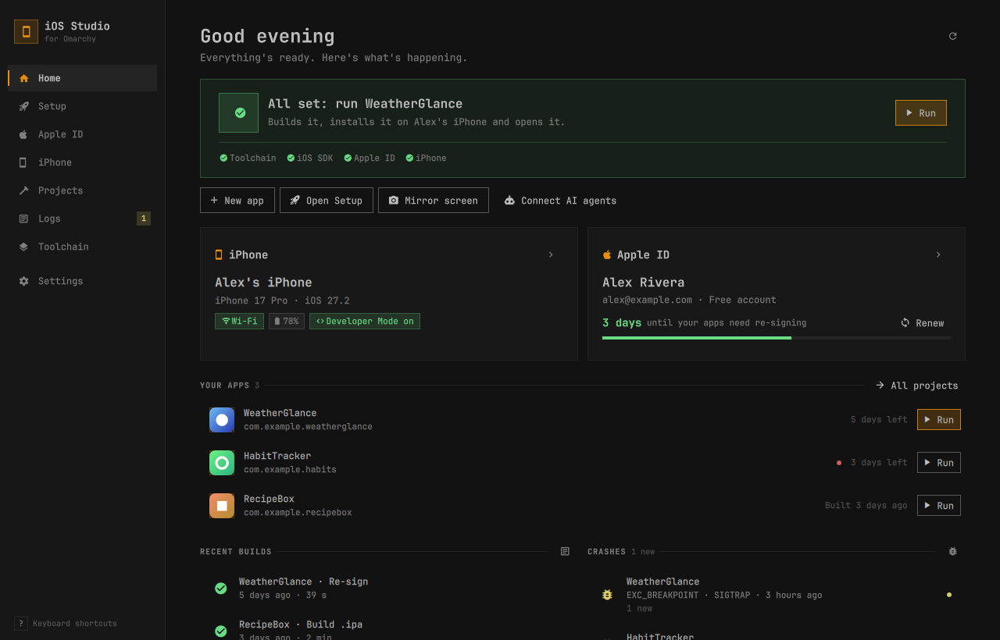

From top to bottom:

- Next step: one card with the most useful thing to do now and a button for it. That can be finishing Setup, signing in, connecting or unlocking the iPhone, turning on Developer Mode, renewing signing that's about to run out, creating your first app, or, once everything is ready, running your latest app. While a build runs, the card shows its progress.
- Readiness: a check for Toolchain, iOS SDK, Apple ID and iPhone.
- Quick actions: New app, Open Setup, Mirror screen and Connect AI agents.
- The iPhone card shows the name, model, iOS version, connection, battery and Developer Mode, with a fix button when something needs you.
- The Apple ID card shows your account, whether it's free or paid, and how many days are left until your apps need re-signing, with Renew.
- Your apps lists recent projects, each with Run. `j`/`k` move between them and `Enter` runs one.
- Recent builds and Crashes show the last few builds with their result, and the newest crash per app with how many reports it has. Click one to open it in Logs.

On a fresh machine, Home shows what Setup will do instead.

### Setup

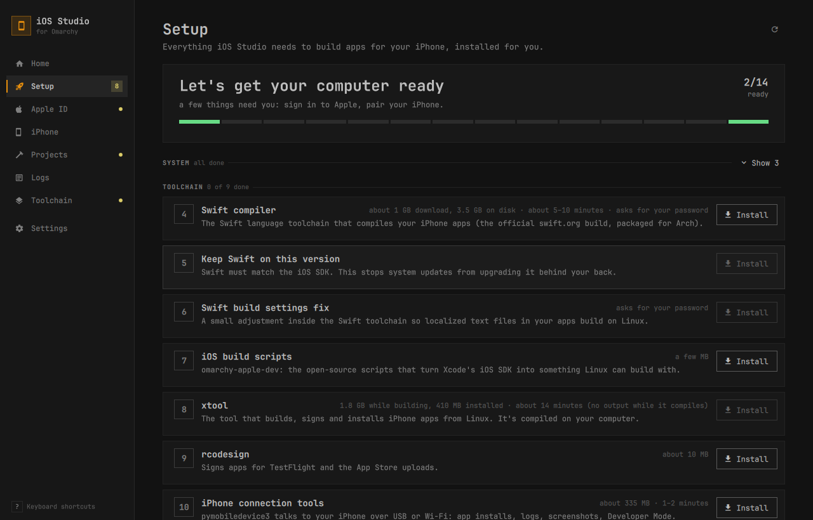

Everything iOS Studio needs, grouped into System, Toolchain, Apple and iPhone. Each step shows whether it's done, missing or broken, how big it is and how long it takes. Broken steps get a Repair button.

- Install everything runs every missing step in order. You type your password once, for the system packages and Swift. Everything else goes into your home folder.
- You can stop an install. Finished steps stay installed.
- The Xcode step opens Apple's download page and watches your Downloads folder. When the file arrives, iOS Studio checks that it's the right version and builds the iOS SDK from it. If you already have the file somewhere else, use "I already have it…".
- The iPhone steps walk you through Trust, Developer Mode and trusting your own apps.

### Apple ID

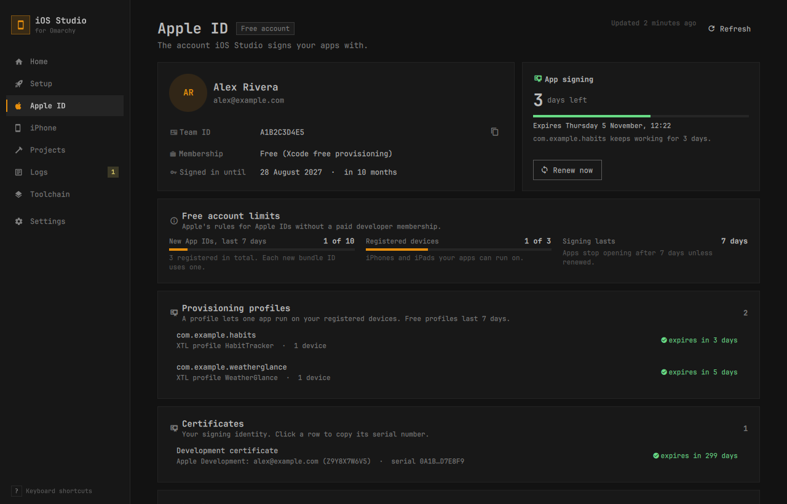

Sign in with your Apple ID (email, password, then a 6-digit code). Teams on the paid Apple Developer Program can sign in with an App Store Connect API key instead.

Once you're signed in, the page shows:

- your team, its ID, and whether it's free or paid
- when your apps' signing runs out, with a Renew now button
- the free-account limits and how much of each you've used: new App IDs this week (10), registered devices, and the 7-day signing period
- your provisioning profiles, certificates, App IDs and registered devices

Sign out is at the bottom. Apps already on your phone keep working until their signing runs out.

### iPhone

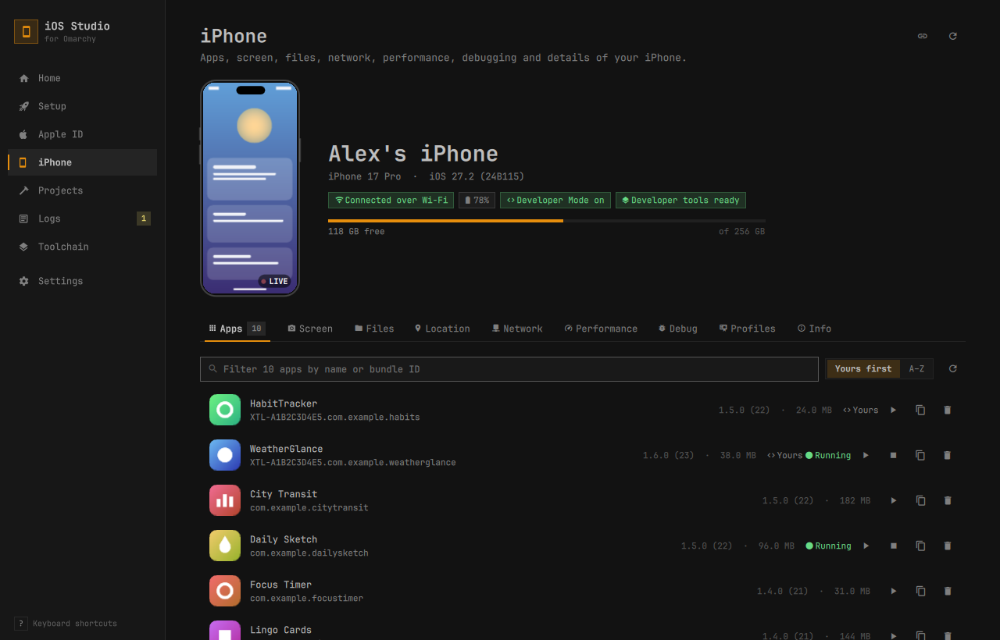

If no phone is paired, the page offers two ways to pair: with a cable (any iPhone) or over Wi-Fi only (iOS 27 or later). Once paired, it shows the phone's model, iOS version, battery, storage, Developer Mode and connection, with these tabs:

| Tab | What it does |
|---|---|
| Apps | Lists installed apps, yours first. Open, stop or remove an app, or copy its bundle ID. |
| Screen | Watch the phone's screen, record short videos for bug reports, and take screenshots. Elements lists the buttons and texts of the app on screen and presses them; Audit runs Apple's accessibility audit; Compare checks a screen against a saved screenshot of it. See [Screen](#screen) below. |
| Files | Import photos and videos from the camera roll, browse and change an app's files, and test camera code with files. See [Files](#files) below. |
| Location | Makes the phone think it's somewhere else. Pick a city or type coordinates. Restore real location puts it back. |
| Network | Test how your app copes with a bad connection: make the whole phone act as if it's on Edge, 3G, LTE, DSL or a lossy network, or running hot, or with a slow GPU. Record an app's traffic over a USB cable and see which servers it talks to. See [Network](#network) below. |
| Performance | Measures one app over time: CPU, memory, energy, frame rate, network, disk and battery, with a report of anything unusual. See [Measure how my app performs](#measure-how-my-app-performs). |
| Debug | Pauses one of your own apps to show what every thread is doing, or stops it at breakpoints so you can step through your code. See [Debugging](#debug-my-app-on-the-iphone). |
| Profiles | The signing profiles on the phone, active and expired. |
| Info | Name, model, iOS version, UDID, serial number, network addresses, battery and storage. |

The link button at the top pairs another iPhone. The phone reconnects by itself whenever it's reachable.

#### Screen

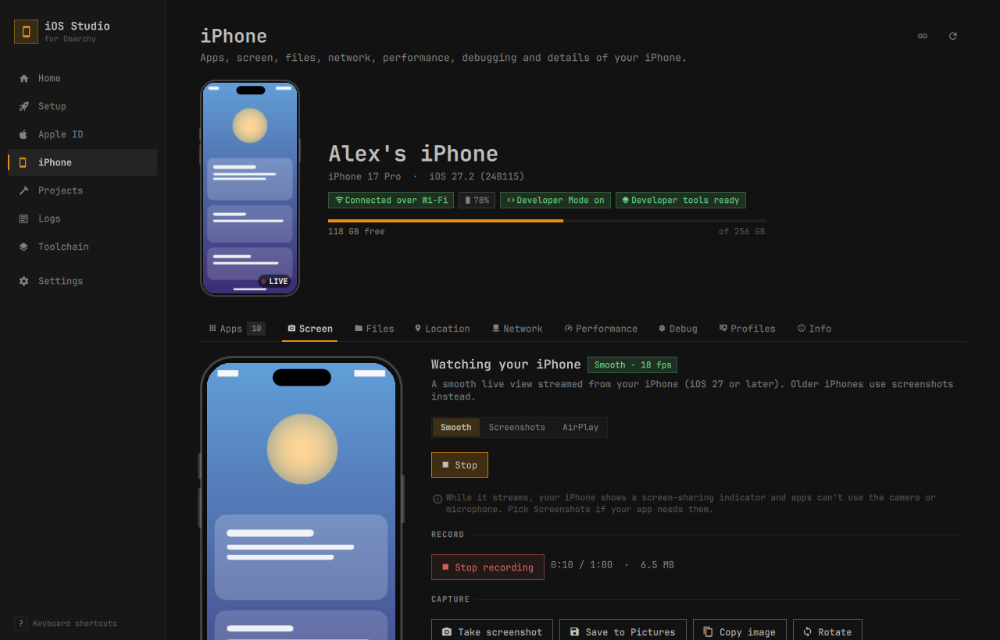

Press Start live view to watch the phone. The badge next to the title says how it's shown and how many frames a second actually arrive. There are three ways to show it:

- Smooth streams the screen as video on iOS 27 or later, which is much smoother than screenshots. While it runs, the phone shows its screen-sharing indicator and apps can't use the camera or microphone. If an app is already using them, or the phone runs an older iOS, the view switches to screenshots by itself and says why.
- Screenshots works on every iPhone and leaves the camera and microphone alone. The phone sets the pace: over Wi-Fi each screenshot takes about 0.6 seconds on a busy screen, so expect 1.5 to 2 frames a second, a little more when the screen is still. Speed caps it lower.
- AirPlay opens UxPlay, a separate receiver window with sound. On the phone, open Control Center › Screen Mirroring and pick iOS Studio. If UxPlay isn't installed, the button takes you to its Setup step.

Record saves a short video of the screen, up to 30 seconds, 1 minute or 5 minutes. The phone shows REC and a timer while it records, and Stop recording ends it early. The video is an MP4 in `~/.cache/ios-studio/recordings/`. Show in folder and Copy path help you attach it to a bug report, and the finished video plays inline when Qt Multimedia is installed. Recordings in Screenshots mode need ffmpeg; if it's missing, the error has a button that installs it from Setup.

Take screenshot saves a full-resolution still. Save to Pictures and Copy image use the latest frame or screenshot.

The tabs beside the phone switch between this Live view, Elements and Audit, which read the app on the screen (see [Read the screen and check accessibility](#read-the-screen-and-check-accessibility)), and Compare, which checks the screen against a saved baseline (see [Check a screen against a baseline](#check-a-screen-against-a-baseline)).

#### Files

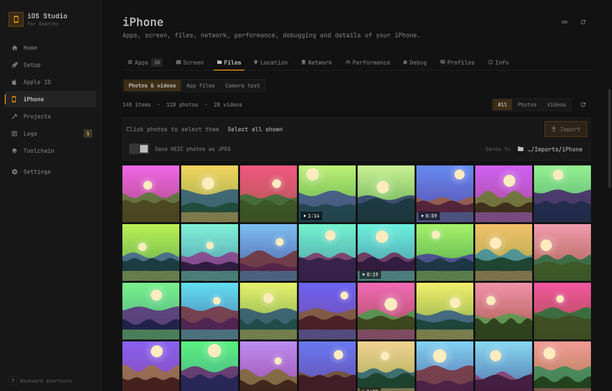

Files has three parts, and nothing here ever changes the camera roll.

- Photos & videos shows the camera roll as thumbnails. Select some (Shift+click selects a range) and import them to a folder (`~/Pictures/iPhone` unless you pick another). HEIC photos can be saved as JPEG.
- App files browses an app's files. Your own apps show their whole container; App Store apps show only their Documents folder, and only if they share files. Save files to this computer, add files with Add files or by dragging them onto the list, make folders and delete.
- Camera test runs your app's camera code on test images and videos. See [Test camera code with files](#test-camera-code-with-files).

#### Network

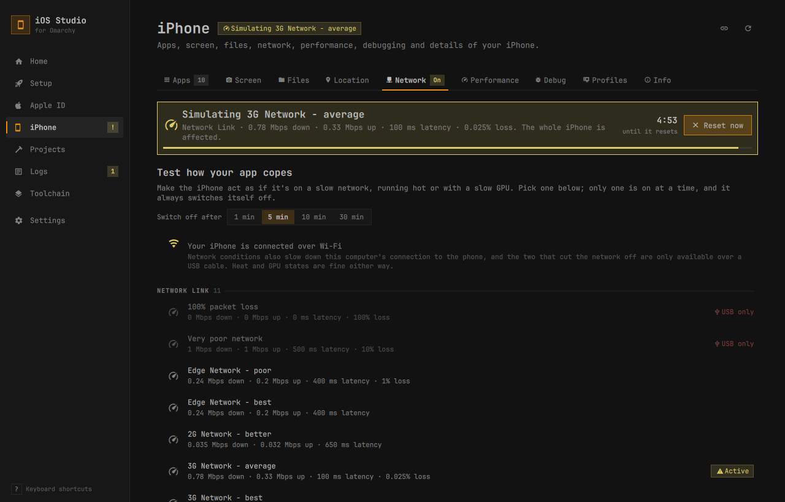

Simulated conditions come from the developer tools on the phone, so they need Developer Mode. Pick one from the list, choose how long it should last (1 to 30 minutes, 5 by default) and press Apply. It affects the whole phone and every app on it, so iOS Studio asks first. Only one condition is on at a time; applying another replaces it.

While one is on, a yellow banner at the top of the tab shows it with a countdown and a Reset now button. The iPhone page title and the sidebar also show it, so you don't forget it on another page. It switches off by itself when the time runs out, when you press Reset now, when you close iOS Studio, or when the connection to the phone drops.

Over Wi-Fi, a network condition also slows down this computer's own link to the phone, and iOS Studio may lose the phone for a moment (the condition then switches off). The two profiles that cut the network off almost completely, 100% packet loss and Very poor network, are only offered over a USB cable. Heat and GPU states work the same over Wi-Fi and USB.

Packet capture needs a USB cable, because the phone only shares its traffic over a cable. Pick an app (or the whole iPhone) and a duration, press Start capture, and use the app. You see the packet count while it records. When it stops, the tab shows the data sent and received, the protocols, and the servers the app talked to. The summary reads only the packet headers, never their contents, and leaves out iOS Studio's own connection to the phone. The recording is a standard pcapng file in `~/.cache/ios-studio/captures/` (the newest 20 are kept). Open in Wireshark opens it, and Setup can install Wireshark if you don't have it.

### Projects

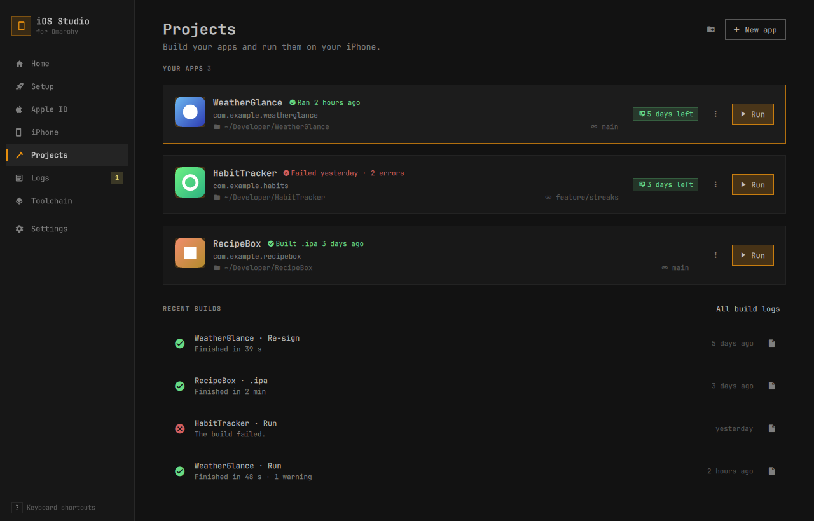

Your apps. iOS Studio looks for xtool projects (a folder with `Package.swift` and `xtool.yml`) in your project folders, which you set in Settings.

- New app (`n`) creates an app from a template: a simple SwiftUI app, a tabs app, or a list with a detail screen.
- The folder button (`a`) adds a project you already have. A plain Swift package can be turned into an app; iOS Studio adds an `xtool.yml` and leaves your code alone.
- Run builds the app, signs it, installs it on your iPhone and opens it, with its output shown in Logs › Console. It needs a connected iPhone; without one, Run takes you to the iPhone page.
- The arrow next to Run picks a run preset: launch arguments, environment variables and a language that Run opens the app with. A card with one selected says "Runs with German" after the bundle ID (see [Run with a preset](#run-with-a-preset-language-arguments-environment)).
- The same menu turns on Watch for changes (`w`): the project compiles each time you save, and the card shows how it went ("Watching · compiled 12 s ago", "Compiling…", "Watching · 2 errors"). Click that text to open the problems. See [Compile on save](#compile-on-save-watch-mode).
- Each project card also has Check build (compile only), Format project…, Lint project, Build .ipa, Re-sign & reinstall, Auto-renew, Run presets, Build settings, Open in editor and Open folder. Check build and Build .ipa work without an iPhone; Re-sign & reinstall needs one.
- A project whose `xtool.yml` is generated by its own scripts has its build buttons off until its Build settings allow it (see [Build a project that has its own build script](#build-a-project-that-has-its-own-build-script)).
- A card whose folder line ends with "Build once to enable completion" has no build server file yet, so your editor can't offer completion in it. Any build (Check build is enough) fixes that. Editors themselves are set up once in Settings (see [Set up my editor](#set-up-my-editor-vs-code-zed-neovim)).
- Below a project's details, a line like "2 settings warnings" means the project check found mistakes in its settings (see [Settings warnings on a project card](#settings-warnings-on-a-project-card)).
- The build panel (`b`) shows progress, a Problems list and the full log. Hiding the panel doesn't stop the build.
- Format project… (`F`) shows what swift-format would change before it writes anything; Lint project (`L`) lists style warnings in the build panel's Problems. See [Format and lint my code](#format-and-lint-my-code).

The Problems list covers more than compiler errors. An error in your code shows its file and line, and clicking it opens that line in your editor. Problems outside your code have no file: linker errors, Swift packages that can't be fetched or resolved, signing, the iPhone, the toolchain and project settings (`xtool.yml`, `Info.plist`). These show their category, a few lines of detail (the missing symbols of a linker error, for example) and a hint saying what to do.

Before xtool starts, every build checks the project's settings. What it finds shows first in the Problems list, marked "Pre-build check". These are warnings: the build goes on and they never make it fail. The result banner counts them apart, for example "3 warnings (2 in project settings)".

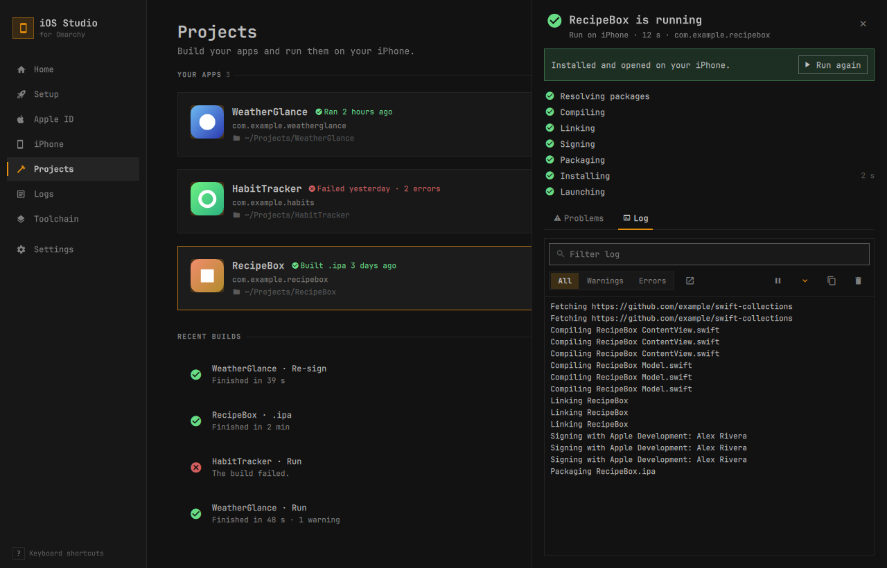

### Logs

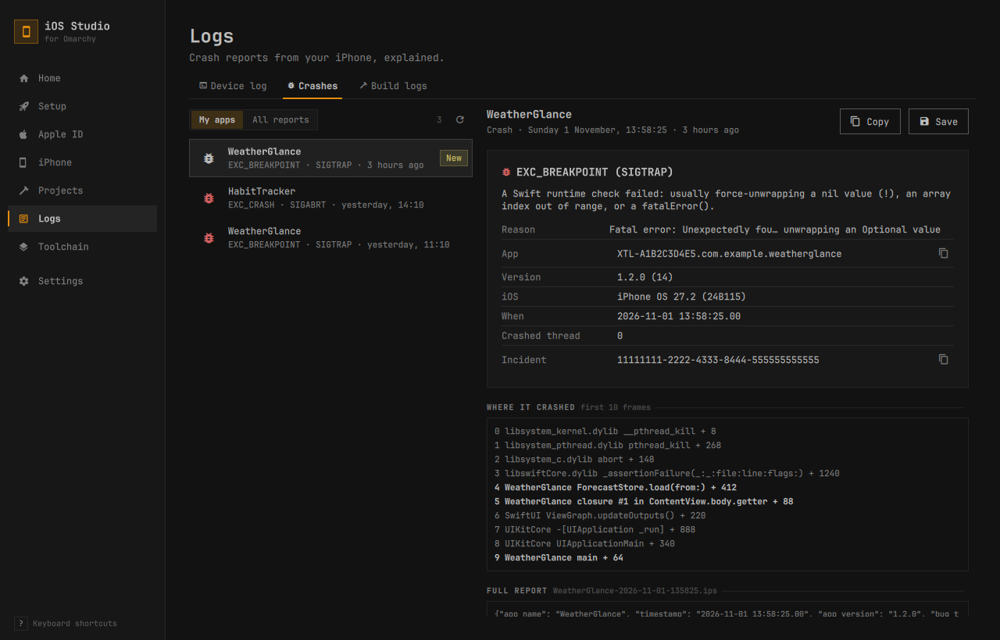

Four tabs:

- Device log is your iPhone's live log. Filter by app or process and by level, search, pause with `Space`, and export the visible lines to Downloads. It keeps streaming while you're on other pages.
- Console shows what your app prints: Swift `print()`, stdout and stderr. See [See what my app prints](#see-what-my-app-prints).
- Crashes lists crash reports from the phone, with new ones marked. Each report opens with a summary (the reason, the app and version, the crashed thread and the first frames of where it crashed) and the full report below. Your app's frames show the file and line, and a click opens them in your editor. You can copy or save the report.
- Build logs has every build you ran, with its problems and full log. Rebuild runs it again.

### Toolchain

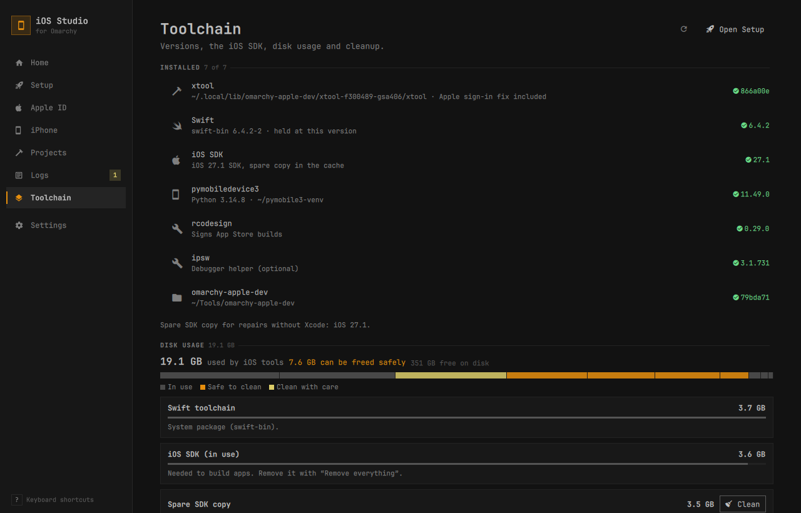

Installed versions of xtool, Swift, the iOS SDK, pymobiledevice3, rcodesign, ipsw and omarchy-apple-dev, each with Install or Repair. Below that you see disk usage per piece, how much can be freed safely, and a Clean button for each item. Remove everything is at the bottom.

### Settings

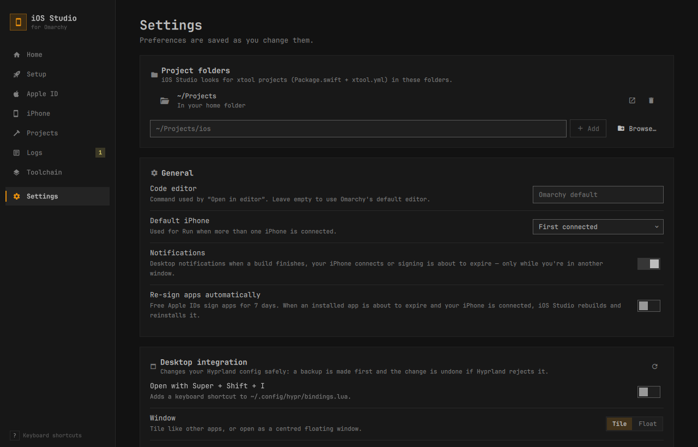

- Project folders: where iOS Studio looks for apps. Until you change the list, it uses whichever of `~/Developer`, `~/Projects`, `~/projects`, `~/Code`, `~/code`, `~/src`, `~/dev` and `~/Work` exist. New apps go to `~/Developer` (created when you make your first app), or to the first folder in your list.
- Code editor: your editor (Omarchy's default, an installed one or any other command), which Open in editor and error links use, and Swift completion for Zed, Neovim and VS Code. See [Set up my editor](#set-up-my-editor-vs-code-zed-neovim).
- Default iPhone, for when more than one is connected.
- Notifications for a finished build, a connected iPhone or signing that's about to expire. They only appear while you're in another window.
- Re-sign apps automatically: adds a background job that checks once a day at 10:00 and renews the apps you marked with Auto-renew. See [Renew before the 7 days run out](#renew-before-the-7-days-run-out).
- AI agents: connects coding agents such as Claude Code to iOS Studio. See [AI agents](#connect-an-ai-agent) below.
- Open with Super + Shift + I adds a shortcut to `~/.config/hypr/bindings.lua`. iOS Studio backs up the file first and undoes the change if Hyprland rejects it.
- Window: tile like other apps, or open as a floating window.
- Opaque window (on by default) keeps the window solid so text is easier to read. Turn it off to use Omarchy's slightly see-through windows.
- About shows versions and where iOS Studio keeps its files, plus Run setup again.
- Uninstall iOS Studio removes the launcher entry, the icon, the `ios-studio` command, the theme hook and iOS Studio's Hyprland rules and shortcut, turns off automatic re-signing and disconnects your AI agents, then quits. It's the same as `ios-studio --uninstall`. The toolchain stays; Toolchain › Remove everything removes it.

## Keyboard shortcuts

Press `?` in the app to see these.

| Keys | Action |
|---|---|
| `1` – `8` | Jump to a page |
| `Ctrl Tab` | Next / previous page |
| `j` `k` / `↑` `↓` | Move the cursor |
| `Enter` | Open or run the highlighted item |
| `Esc` | Close the top sheet, clear search, or go back |
| `r` | Refresh this page |
| `/` | Search on this page |
| `x` | Remove the highlighted item (asks first) |
| `c` | Copy the highlighted value |
| `?` | Show or hide the shortcut sheet |

Projects also has `n` (new app), `a` (add a project), `b` (build panel), `w` (watch the highlighted project for changes, or stop), `F` (format the highlighted project) and `L` (lint it). On the Device log and the Console, `Space` pauses. On iPhone › Screen › Elements, `Enter` presses the highlighted element on your iPhone, and on Audit it shows the issue's element; `s` takes a screenshot.

## Common tasks

### Run my app on my iPhone

1. Connect the iPhone (cable or Wi-Fi) and unlock it.
2. On Projects, press Run on your app.
3. The first time only, on the iPhone: Settings › General › VPN & Device Management › your Apple ID › Trust.

If the build fails, the Problems tab in the build panel lists each problem. Click an error in your code to open it in your editor. For the others, such as a package that can't be downloaded or a signing problem, follow the hint under the message.

### See what my app prints

On a real iPhone, `print()` output never reaches the phone's log, so iOS Studio collects it when it starts the app.

1. Press Run on Projects, or open Logs › Console, pick one of your apps and press Launch. Launch restarts the app if it's already running.
2. The output appears live. Filter it, pause with `Space`, copy, export it to Downloads or clear the view. stderr lines are marked `err`.
3. Each launch keeps its own output. With several launches, a picker switches between them; the view follows the newest one.

Only apps that iOS Studio started show output here. Messages from `os_log`, `Logger` and `NSLog` go to the Device log tab instead. If nothing shows up, see [troubleshooting](troubleshooting.md#nothing-in-logs--console). [features/app-console.md](features/app-console.md) explains how it works and its limits.

### Renew before the 7 days run out

With a free Apple ID, apps stop opening 7 days after you signed them. The project card and the Apple ID page show how much time is left.

- To renew by hand, press Re-sign & reinstall on the project card. Your app's data on the phone stays.
- To renew automatically, turn on Auto-renew on the project card and Re-sign apps automatically in Settings. iOS Studio then checks once a day and renews marked apps that expire within 2 days, as long as the iPhone is reachable. If it needs a new certificate, it sends you a notification instead of replacing it.

### Pair a new iPhone over Wi-Fi

Wi-Fi-only pairing needs iOS 27 or later and both devices on the same Wi-Fi.

1. On the iPhone, turn on Developer Mode: Settings › Privacy & Security › Developer Mode.
2. In iOS Studio, open iPhone and press Pair over Wi-Fi (or the link button at the top, if a phone is already paired).
3. On the iPhone, open Settings › Developer › Paired Macs and tap iOS Studio under Other Devices.
4. A 6-digit code appears on one side. Type it on the other: the code iOS Studio shows goes into the iPhone, and the code the iPhone shows goes into iOS Studio.

With a cable it's simpler: plug in, unlock, tap Trust. iOS Studio sets up Wi-Fi access at the same time.

### Measure how my app performs

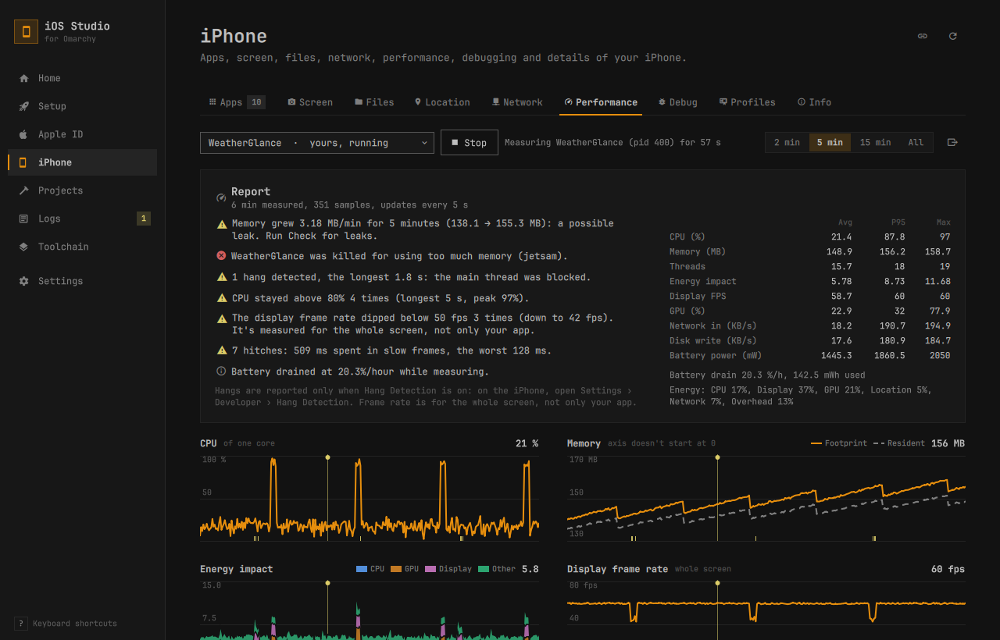

1. On the iPhone page, open the Performance tab.
2. Pick the app. Running apps come first, and your own apps are marked "yours".
3. Press Start measuring, then use the app on the phone as you normally would. If the app isn't open yet, the tab waits for it.

The charts update about once a second. Hover over one to read the values at that moment on every chart. Marks on the charts show events: red when the app was killed or crashed, yellow for a hang or a hitch. The time buttons show the last 2, 5 or 15 minutes, or everything (about the last hour is kept).

The report above the charts says what stood out, for example "Memory grew 3.2 MB/min for 4 minutes: a possible leak", CPU staying above 80%, the frame rate dipping, a hang, or the app being killed for using too much memory. It also lists the average, 95th percentile and highest value of the main numbers. The export button saves every sample to Downloads as a CSV file.

The frame rate is for the whole screen, not only your app, because that's what the phone reports. Measuring keeps going while you're on other pages, and stops when you press Stop or close iOS Studio.

Hangs only show up when Hang Detection is on. On the iPhone, open Settings › Developer › Hang Detection and switch it on. The Developer menu is there once Developer Mode is on.

Below the charts are three deeper checks, and each one asks before it starts:

- Track hitches records every frame for 60 seconds and marks the ones that took too long. The phone and your computer work harder while it runs.
- Profile launch quits the app, starts it again and shows how long loading, static initializers and the first frame took. Anything unsaved in the app is lost. Loader timing works only for your own apps.
- Check for leaks pauses the app for a few seconds and counts objects that nothing points to any more. It works only for your own apps while they're running. It saves a memory graph file you can open in Xcode on a Mac.

### Read a crash report

1. Open Logs › Crashes with the iPhone connected.
2. "My apps" shows only your apps' crashes. Pick one.
3. Read the summary at the top. The reason and "Where it crashed" usually point at the problem. Save or copy the full report if you need to share it.
4. Your app's frames show the function and the file and line it crashed on. Click one to open that line in your editor. This works for crashes from builds you ran from iOS Studio on this computer; if a crash came from an older build, the note under the frames says so, and rebuilding that version and reproducing the crash gives you the lines.

### Test camera code with files

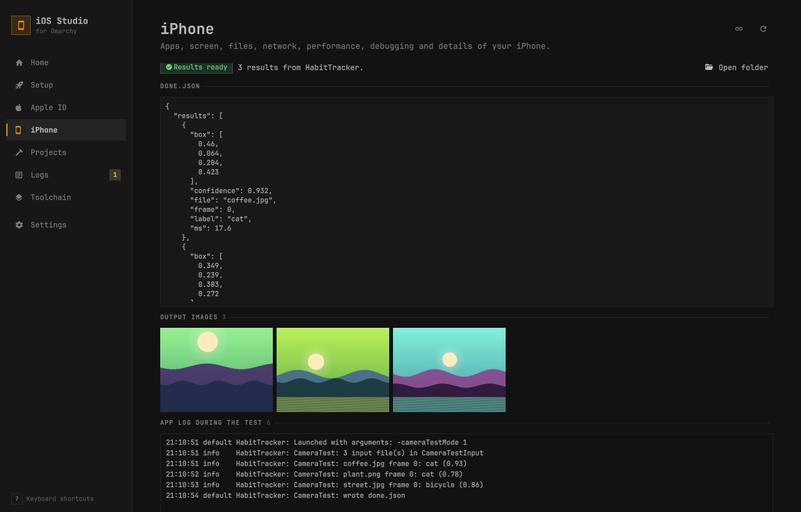

Camera code is hard to test by pointing the phone at things. Files › Camera test feeds your app chosen images and videos instead and shows what it made of them.

1. Add the test hook to your app once. [camera-testing.md](camera-testing.md) has the Swift code to paste.
2. Build and run the app on the iPhone from Projects.
3. On the iPhone page, open Files › Camera test. Pick the app, add images or videos (or drop them on the list) and press Run test.

iOS Studio copies the files into the app's Documents/CameraTestInput, restarts the app with `-cameraTestMode 1`, waits for the app to write Documents/CameraTestOutput/done.json, and copies the results back. You get done.json, any images the app wrote, the app's log during the run and a warning if it crashed. If no done.json shows up before the timeout, the app is missing the hook or the launch argument.

### Debug my app on the iPhone

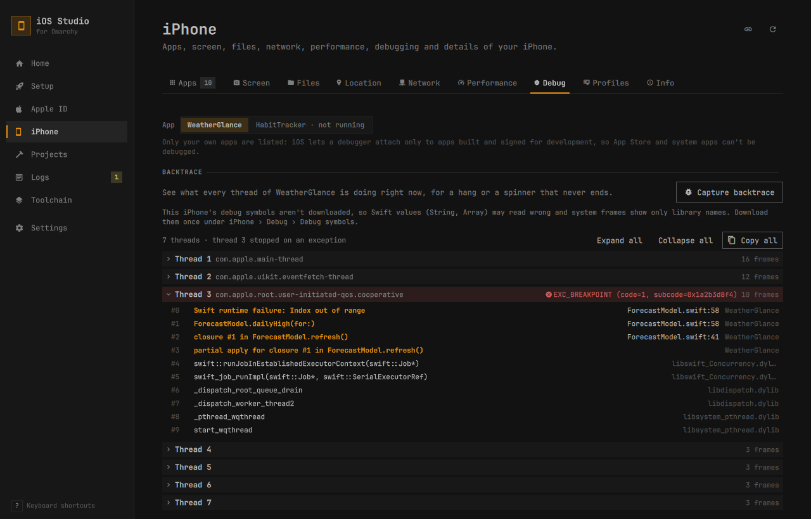

Open iPhone › Debug and pick your app. Only your own apps are listed: iOS lets a debugger attach only to apps built and signed for development, so App Store and system apps can't be debugged. For readable results, build and run the app from Projects first, so iOS Studio has its build.

- Capture backtrace, for an app that hangs or spins: the app pauses for a few seconds while the debugger reads every thread, then runs on. The thread that stopped on an exception (else the main thread) opens first, and your own code is highlighted with its file and line. Click a frame to copy it.
- Breakpoints: pick a file from the app's Sources and type a line, or type a function name such as `ForecastModel.refresh`. Then press Start debugging. Attach to the running app keeps it as it is; Restart it paused closes it and starts it again, paused until the debugger is ready, so breakpoints in startup code also hit. When the app stops, you see where, the call stack and the variables of the selected frame. Continue, Step over, Step in and Step out move on; Pause stops a running app. Detach ends debugging and the app keeps running, and the stop button quits the app instead.
- Debug symbols: the iPhone's Swift runtime and the system libraries lldb needs, downloaded once per iOS version. Without them everything still works, but Swift values such as strings and arrays can read wrong, system frames show only library names and attaching is slow. It needs ipsw from Setup. See [Debug symbols](#debug-symbols) below.

The debugger is lldb from the Swift toolchain. It needs Python 3.12, which Setup's optional "Debugger support" step installs; the Debug tab links there when it's missing. Over Wi-Fi, attaching takes about 30 seconds.

#### Debug symbols

The Debug symbols card at the bottom of iPhone › Debug shows where the symbols for the phone's iOS version stand and offers one button to fix them:

| The card says | What it means | Button |
|---|---|---|
| Not downloaded | No symbols for this iOS version yet. | Download debug symbols |
| Ready | lldb uses them by itself. | none (Remove only) |
| Needs an update | They came from an older version of iOS Studio and miss system libraries, so attaching can take minutes over Wi-Fi while the app stays paused. They still work until you update. | Update symbols |
| Incomplete | Some libraries are missing; the card names them. | Update symbols |
| Failed | The last download or unpack failed; the card shows why. | Try again |

When the download is still on disk, the button is Unpack again instead: it unpacks the libraries from that download in about a minute, without downloading anything. That happens after a failed or cancelled unpack, and whenever Keep the download is on. Updating keeps your current symbols working until the new ones are ready, and Cancel leaves them as they were. While the symbols need an update, the Debug tab also shows a warning under the app picker with the same button.

Disk use: the download is about 7 GB and needs that much free space while it runs. The unpacked symbols take a few hundred MB. Keep the download (the switch under the buttons) keeps the 7 GB so the symbols can be unpacked again later; it's off by default, and turning it off deletes a kept download once the symbols are ready. Remove deletes the symbols and any kept download for this iOS version, after asking. Everything lives in `~/.cache/ios-studio/DeviceSupport/`.

### Free space

The iOS SDK and its build copies are large. Open Toolchain and look at Disk usage. Items marked safe, such as old SDK copies, build leftovers, old xtool builds and the Swift download, can be cleaned without breaking anything. Once the SDK is built, you can usually delete the Xcode download too. Each Clean asks first and shows how much it frees.

iOS Studio also deletes its own oldest files as new ones arrive. It keeps the logs of the last 300 builds, and the newest 30 screenshots, 20 screen recordings, 20 packet captures, 10 memory graphs from leak checks and 20 camera test results, fewer if they grow past a size limit. Save anything you want to keep somewhere else.

### Settings warnings on a project card

Some mistakes in a project's settings don't stop a build. xtool ignores an `xtool.yml` key it doesn't know, so a misspelled `bundleId:` does nothing. An app that uses the camera without a camera permission text (`NSCameraUsageDescription`) in its `Info.plist` builds and opens, then crashes the first time it asks for the camera. iOS Studio checks each project for mistakes like these when you open Projects, when you move to a card and after each build. It only reads your files and takes under a second.

When it finds something, the card shows a line like "2 settings warnings". Click it to see each one with its file and line and a hint saying what to fix; click an issue to open that line in your editor. After you fix it, press Check again. The card's More also shows "no problems found" for a clean project.

It checks:

- `xtool.yml`: unknown or misspelled keys (with the key you probably meant), a missing `version`, `bundleID` or `orgID`, and files it points to that don't exist,
- `Info.plist`: a missing or empty permission text for something your code uses, such as the camera, microphone, location, photos, contacts, Bluetooth or Face ID,
- the icon: a 1024×1024 PNG without transparency (no icon at all is only a note),
- entitlements a free Apple ID can't get, such as push notifications, app groups or iCloud (ignore these if you have a paid account),
- the bundle id and the version numbers.

The same warnings show in the build panel's Problems list as "Pre-build check". None of them stops a build. See [features/project-check.md](features/project-check.md) for every check.

### Build a project that has its own build script

Some projects build with their own `run.sh`: it regenerates `xtool.yml` first, sets environment variables or raises the open-file limit. iOS Studio refuses a project whose `xtool.yml` is generated (its Run button is off) until you allow it:

1. On Projects, open the project's More (`m`) and choose Build settings.
2. If the project's scripts suggest settings, a note lists them; Use these fills the form. Check the prebuild command's arguments (a script may want a server address, for example).
3. Prebuild command: the script that regenerates `xtool.yml`, such as `./generate.sh`. It runs in the project folder before every build, without a shell, so `|`, `&&` and `$VARIABLES` don't work.
4. Environment variables: Add variable for each `NAME = value` the build needs.
5. Open-file limit: the number the script passes to `ulimit -n`, or empty for 65536.
6. Turn on Build generated project and press Save.

The next Run starts with Running the prebuild command; its output is in the build log. See [features/project-build-settings.md](features/project-build-settings.md).

### Set up my editor (VS Code, Zed, Neovim)

Code completion and inline errors for Swift come from SourceKit-LSP, which comes with the Swift toolchain. Your editor needs to be set up once to use it with xtool projects, and iOS Studio does that for you.

1. Open Settings › Code editor. Under Swift completion there's one row per editor you have installed: Ready, Not set up, or One step left (with the step, such as installing Zed's Swift extension). Editors that aren't installed share one quiet line.
2. Press Set up… on your editor's row. Nothing changes yet: the row lists what it would do, as Create (a new file), Update (keys added to a file you have; your own keys stay), Keep (already right, left alone) and Back up.
3. If it changes your editor's own config, the row says so in plain words above the button, and the button names it: Change Neovim config. For Neovim with LazyVim (Omarchy's default) that's LazyVim's Swift extra in `~/.config/nvim/lazyvim.json`, with a copy of the file saved first, or a small plugin file in `~/.config/nvim/lua/plugins/` when your LazyVim has no Swift extra. It applies to every project you open in Neovim.
4. Press the button (or Cancel). The row shows what it did and the next step, such as restarting Neovim.

Setting an editor up also makes it Your editor, which Open in editor uses; you can pick another one there any time. A Neovim config that isn't LazyVim isn't changed: its row says "Set up by hand" and Snippet opens the lines to add.

Each project also needs a build server file (`.bsp/xtool.json`), which tells SourceKit-LSP how xtool builds it. xtool writes it on the first build, so a project you haven't built yet says "Build once to enable completion" on its card. Nothing shows once it's ready. iOS Studio never overwrites a settings file: it adds the keys it needs, or leaves the file and says why.

See [features/editor-setup.md](features/editor-setup.md) for the files each editor gets and how to set one up by hand.

### Run with a preset (language, arguments, environment)

A run preset saves how Run opens your app, so you don't type it again: the app in German, a debug menu switched on, test data instead of the real server. Each project has its own presets.

1. On Projects, click the arrow next to Run and choose New preset… (or Edit presets… once there are some). More › Run presets opens the same sheet.
2. Give it a name, such as German.
3. Language: the language the app's text shows in, for this launch only. Region formats dates, numbers and currency; Use de_DE fills in the usual one for the language.
4. Launch arguments: Add argument for each one, for example `-ShowDebugMenu` and `YES`. Environment variables: Add variable for each `NAME = value`.
5. UI test mode adds `-UITestMode YES`. iOS ignores it; your app can read it to skip onboarding or load test data.
6. "What Run passes to the app" shows the exact arguments and environment. Press Save preset.

Pick the preset in Run's menu (or Use for Run in the sheet). The card shows "Runs with German", and every Run, including Run on Home, opens the app with it until you choose Default (no preset). The build panel names the preset while it runs. The choice is kept after a restart. Check build, Build .ipa and Re-sign & reinstall don't use presets.

Your app reads its arguments through `UserDefaults`:

```swift
let showDebugMenu = UserDefaults.standard.bool(forKey: "ShowDebugMenu")   // -ShowDebugMenu YES
let uiTesting = UserDefaults.standard.bool(forKey: "UITestMode")
```

Good to know:

- The language only changes the text if the app has that language (a German localization for German). Otherwise iOS shows the app's own language.
- The preset applies when iOS Studio starts the app, which closes a running copy first. Opening the app from the home screen afterwards starts it without the preset.
- Your iPhone's own language and region don't change.
- Presets are kept in iOS Studio, not in the project folder. They aren't the environment variables in Build settings, which go to the build and not to the app.

See [features/run-presets.md](features/run-presets.md) for every field, the limits and how AI agents use presets.

### Compile on save (watch mode)

Watch mode compiles your app each time you save a file, so errors show up a few seconds after you stop typing, without pressing Build.

1. On Projects, click the arrow next to Run and choose Watch for changes (or highlight the project and press `w`).
2. Edit and save in your editor. The card shows "Change seen…", then "Compiling…", then the result: "Watching · compiled just now" (green), "Watching · 1 warning" or "Watching · 2 errors" (red).
3. Click the result to open the build panel's Problems tab. It fills in after every compile on save, like a Build does, and Log shows that compile's output. Clicking an error opens its line in your editor.
4. To stop, choose Watch for changes again in Run's menu (it has a check while it's on), or press `w`.

While a project is watched, the sidebar shows a small eye next to Projects, so you can see it from any page: faint while it waits, accented while it compiles, red when the last compile failed. Hover it for the project's name and state.

Run after a clean compile, in the same menu, also installs and opens the app on your iPhone each time the code compiles without errors. It needs a connected iPhone and an Apple ID; until then the menu row is greyed out and says what's missing. The card then says "Watching · ran just now".

Good to know:

- One project is watched at a time. Watching another one stops the first (the menu row says "instead of HabitTracker").
- AI agents can start and stop the watch too (see [mcp.md](mcp.md)). A watch an agent started shows on the card and in the sidebar the same way, and you can stop it from the menu.
- Saving several files quickly gives one compile, not one per save. A save during a compile cancels it and compiles again with the new code.
- A compile on save is the same compile as Check build: it needs no iPhone and no Apple ID. Recent builds and Logs › Build logs list it as "Compile on save", and a run after it as "Run on save".
- Pressing Build or Run while the watch is compiling the same project doesn't start a second build: iOS Studio asks you to try again in a few seconds. While your own build runs, the watch waits and compiles after it.
- The watch stops when you close iOS Studio, unless an agent still uses it.

See [features/watch-mode.md](features/watch-mode.md) for what is watched, the timings and the agent tools.

### Read the screen and check accessibility

iPhone › Screen can read the app that's open on your iPhone as a list: its buttons, texts, switches and other elements, in the order VoiceOver reads them. It can press them on the phone and run Apple's accessibility audit. It needs Developer Mode, and nothing is installed on the phone.

1. Open the app on your iPhone and leave it in front, with the phone unlocked.
2. On iPhone › Screen, pick Elements and press Read the screen. On a small screen this takes about 5 seconds; a busy one takes longer.
3. Each row shows the element's label, its value, its role and its identifier (the `accessibilityIdentifier` from your code). "No label" means VoiceOver has nothing to read for it. Type in the filter (`/`) to find one.
4. Move to a row with `j`/`k` or the mouse and press Press (or `Enter`). This taps the element on your real iPhone, in the app that's open. iOS Studio then reads the screen again and says what changed, for example "Changed: countLabel Count: 1 → Count: 0". A press takes about 8 seconds.
5. Pick Audit and press Run audit. It looks for low contrast, text that doesn't grow with the text size setting (Dynamic Type), clipped text, touch targets smaller than 44×44 points, missing labels and a few more. Issues are grouped by type. Click one to see its element in Elements.

The highlighted row is outlined on the phone picture when its position is known. On iOS 27.3 the phone doesn't report where elements are, so only audit issues get an outline; the Elements list says so.

Good to know:

- Only the screen showing now is read. Open another screen in your app (or press a button that opens it) and read it again.
- A press is a tap. Typing text and swiping aren't supported.
- Pressing works on what VoiceOver can reach. If a press does nothing, read the screen again: the screen may have changed since.
- If an alert or the keyboard is up, the list stops early and says so.

AI agents use the same thing to check their own changes: they launch the app, read the screen, press a button and read it again. See [features/ui-inspect.md](features/ui-inspect.md) for how it works and its limits, and [troubleshooting](troubleshooting.md#elements-shows-nothing) if the list stays empty.

### Check a screen against a baseline

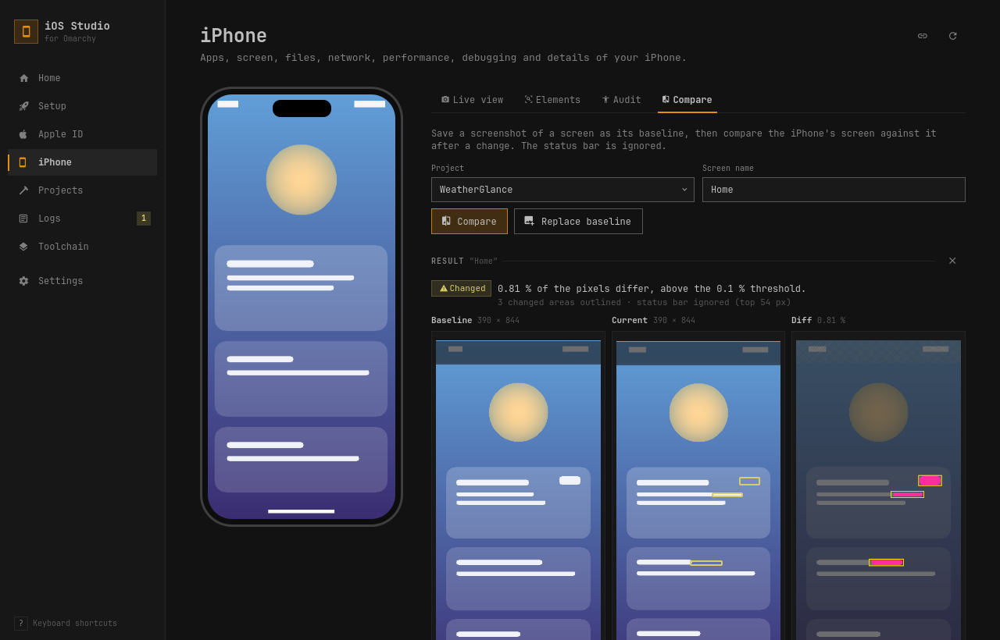

A baseline is a screenshot of one screen of your app that you keep, such as its home screen or its settings. After a change, compare the screen with it: iOS Studio shows how much changed and draws boxes around it, so a moved label or a missing badge is easy to spot.

1. Open the screen on your iPhone.
2. On iPhone › Screen, pick Compare. The project is the one you picked here last, else the last one you built; change it with the Project menu.
3. Type a name for the screen in Screen name, for example `home`, and press Save as baseline. The baselines of the project are listed below; click one to use its name.
4. After a change in your app, open the same screen and press Compare (or `Enter` in the name field).

The result shows the baseline, the new screenshot and the diff image side by side, all the same size. The badge says what came out:

- Same: the screens match, or differ by less than the threshold (0.1 % of the pixels).
- Changed: more than that differs. The changed areas are outlined on the new screenshot; in the diff image changed pixels are pink and boxed in yellow.
- Size mismatch: the screenshots have different sizes, for example from another iPhone model or a turned phone. There's no diff then.
- No baseline: nothing is saved under that name yet. Save as baseline keeps this screenshot.

The status bar (clock, battery, signal) is ignored, so the time never counts as a change; it's shaded on the images. Click an image to open it in your image viewer.

When the change is what you wanted, press Accept as new baseline: the screenshot you just compared becomes the baseline, after you confirm. Replace baseline in the top row takes a new screenshot instead. Delete baseline (or the bin icon in the list) removes a baseline after asking. Comparing needs a connected iPhone; the buttons say why when they can't be used.

Baselines are kept in iOS Studio's data folder, not in your project, and old comparisons are cleaned up by themselves. AI agents use the same baselines. See [features/screenshot-compare.md](features/screenshot-compare.md) for what counts as a change and where the files go.

### Format and lint my code

1. On Projects, open a card's More (⋮) and choose Format project… (or highlight the project and press `F`).
2. The sheet shows how many files would change, the style it uses (your `.swift-format`, or swift-format's default style when there is none) and the diff. Nothing is written yet.
3. Apply to N files writes them. Cancel leaves everything as it was. "Already formatted" means there is nothing to do.
4. Lint project (`L`, same menu) checks the style without changing anything. The warnings show in the build panel under Problems › Style, after the build's own problems. Click one to open its line in your editor. "Formatting fixes 3 of these" has a Format project… button for the ones swift-format can fix itself.
5. Style warnings never fail a build. Hide in the Style header hides them (and keeps them hidden next time); Show brings them back.

SwiftLint is used too when it's installed and on your PATH, with your `.swiftlint.yml`. Details, including which files are formatted: [features/format-lint.md](features/format-lint.md).

### Connect an AI agent

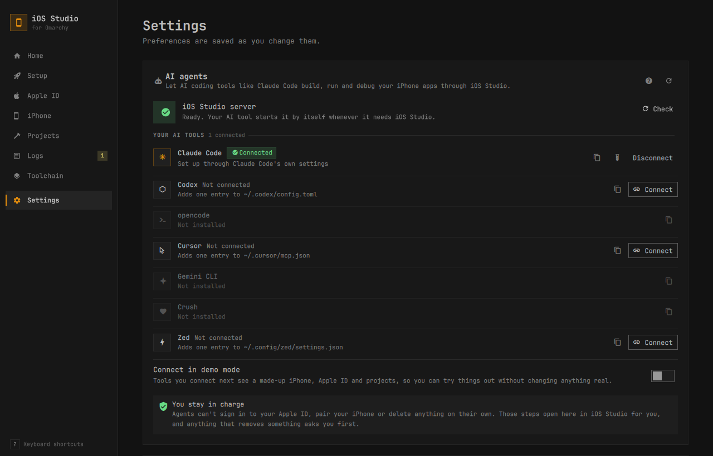

1. Open Settings › AI agents, or press Connect AI agents on Home.
2. If the iOS Studio server isn't ready yet, press Prepare. It downloads about 30 MB once.
3. Press Connect next to your tool, then start a new session in that tool.

Ask the agent something like "Check that iOS development is ready" or "Build HabitTracker and fix the errors". Signing in, pairing and turning on Developer Mode stay with you: the agent opens iOS Studio on the right page and asks you to do it there. Turn on Connect in demo mode to let an agent try things on made-up data first. [mcp.md](mcp.md) has the details and manual setup.
