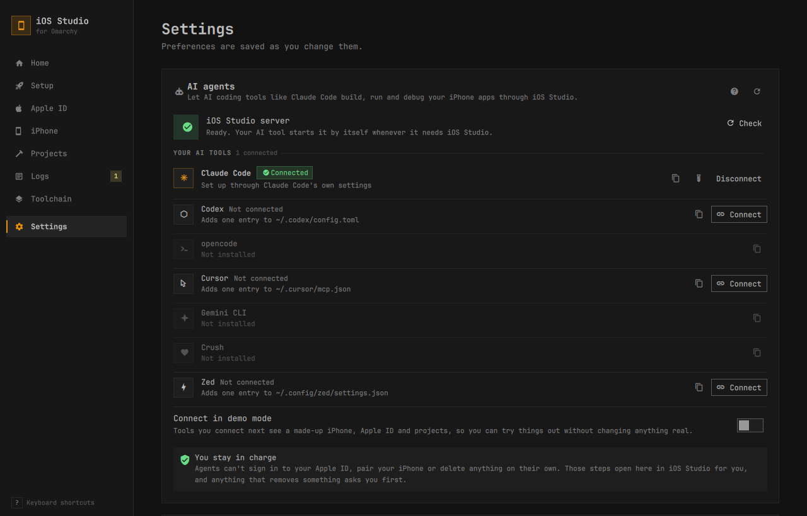

# AI agents (MCP)

iOS Studio includes an [MCP](https://modelcontextprotocol.io) server, so AI coding agents such as Claude Code, Codex, opencode, Cursor, Gemini CLI, Crush and Zed can work on your iPhone apps. An agent can check your setup, create projects, build them, read compiler errors and build logs, fix the code, and install and launch the app on your iPhone.

The server runs on your computer over stdio and uses the same helper as the app. It never sees your Apple ID password or 2FA codes, and it can't pair a phone. For those steps the agent sends you to the iOS Studio window.

## Enable it



Open Settings › AI agents in iOS Studio, or click Connect AI agents on Home. It lists the AI tools it finds on your computer:

1. If the server isn't ready yet, press Prepare. This creates a small Python environment for it in `~/.local/share/ios-studio/mcp-venv` (a one-time download of about 30 MB), so your agent doesn't have to wait the first time it starts the server.
2. Click Connect next to your tool, then start a new session in that tool so it loads the server.
3. Click the test tube button (Test the connection). iOS Studio starts the server the way your tool will and shows how many tools it offers.

How each tool is connected:

| Tool | How | Where it ends up |
|---|---|---|
| Claude Code | `claude mcp add --scope user` | `~/.claude.json` |
| Gemini CLI | `gemini mcp add -s user` | `~/.gemini/settings.json` |
| Codex | edits the config file | `~/.codex/config.toml` (`$CODEX_HOME` if set) |
| opencode | edits the config file | `~/.config/opencode/opencode.json` |
| Cursor | edits the config file | `~/.cursor/mcp.json` |
| Crush | edits the config file | `~/.config/crush/crushrc` (or `crush.json` if that's what you use) |
| Zed | edits the config file | `~/.config/zed/settings.json` |

When iOS Studio edits a config file, it changes only the `iosstudio` entry. It parses the file first (JSON with comments, TOML or crushrc) and leaves your other servers, their order, your comments and formatting alone. It checks the result before saving, keeps a timestamped backup in `~/.local/state/ios-studio/backups/`, and puts the original back if anything goes wrong. If the file already has a mistake in it, iOS Studio leaves it alone and tells you.

Disconnect removes the entry again. The copy button (Copy setup snippet) copies the manual setup for a tool, if you'd rather do it yourself. If a tool shows Needs update, its entry points to a different copy of iOS Studio, usually because the app folder moved; press Update.

With Connect in demo mode turned on, the tools you connect next get the server with made-up data (see [Demo mode](#demo-mode)).

The same actions work from a terminal:

```bash
bin/iosstudio-helper agents list                               # what's installed and connected
bin/iosstudio-helper agents connect --client codex --dry-run   # show the planned change; nothing is written
bin/iosstudio-helper agents connect --client codex             # also: disconnect, --demo
bin/iosstudio-helper agents test --client codex                # initialize + tools/list, prints the tool count
bin/iosstudio-helper agents prepare                            # create or update the server's environment
```

### Set it up by hand

The server is `bin/iosstudio-mcp` in your iOS Studio checkout. With the standard install, that's:

```
~/.local/share/omarchy-ios-studio/bin/iosstudio-mcp
```

The first start creates the server's Python environment (see above) if Prepare hasn't already. It uses `uv` if it's installed and `python -m venv` otherwise, and needs internet. Later starts are instant.

Register that path with your agent. Most config files don't expand `~`, so write the full path, such as `/home/you/.local/share/omarchy-ios-studio/bin/iosstudio-mcp`. The server name is `iosstudio`, without an underscore, because Gemini CLI doesn't allow underscores in server names.

Claude Code:

```bash
claude mcp add --scope user iosstudio -- "$HOME/.local/share/omarchy-ios-studio/bin/iosstudio-mcp"
```

Codex CLI (`~/.codex/config.toml`):

```toml
[mcp_servers.iosstudio]
command = "/home/you/.local/share/omarchy-ios-studio/bin/iosstudio-mcp"
args = []
startup_timeout_sec = 30
tool_timeout_sec = 120
```

opencode (`~/.config/opencode/opencode.json`):

```json
{
  "mcp": {
    "iosstudio": {
      "type": "local",
      "command": ["/home/you/.local/share/omarchy-ios-studio/bin/iosstudio-mcp"],
      "enabled": true,
      "timeout": 120000
    }
  }
}
```

Cursor (`~/.cursor/mcp.json`, also used by `cursor-agent`):

```json
{ "mcpServers": { "iosstudio": { "command": "/home/you/.local/share/omarchy-ios-studio/bin/iosstudio-mcp", "args": [] } } }
```

Gemini CLI:

```bash
gemini mcp add -s user --timeout 600000 iosstudio "$HOME/.local/share/omarchy-ios-studio/bin/iosstudio-mcp"
```

Without `-s user`, the server is added only to the current project. Don't add `--trust`, so Gemini still asks before it runs a destructive tool.

Crush (`~/.config/crush/crushrc`):

```bash
mcp add iosstudio --type stdio --command "$HOME/.local/share/omarchy-ios-studio/bin/iosstudio-mcp" --timeout 120
```

Zed (`~/.config/zed/settings.json`):

```json
"context_servers": {
  "iosstudio": { "command": "/home/you/.local/share/omarchy-ios-studio/bin/iosstudio-mcp", "args": [], "env": {} }
}
```

Then ask the agent something like *"Check that iOS development is ready"* or *"Build HabitTracker and fix the errors"*. If your agent supports MCP prompts, you can also run `fix_build_errors`, `diagnose_crash`, `new_app` or `get_ready` as slash commands.

## Tools

The server has 52 tools, all prefixed `ios_`. Start with `ios_status`. It reports what's ready and, for each problem, which tool fixes it.

| Area | Tools |
|---|---|
| Overview | `ios_status`, `ios_open_app` (opens the app window on a page, for steps only you can do) |
| Projects | `ios_project_list`, `ios_project_info`, `ios_project_templates`, `ios_project_create`, `ios_project_add`, `ios_project_convert`, `ios_project_set`, `ios_project_remove` |
| Builds | `ios_build_start`, `ios_build_status`, `ios_build_diagnostics`, `ios_build_log`, `ios_build_respond`, `ios_build_cancel`, `ios_build_history`, `ios_build_clean`, `ios_run` |
| Apple ID and signing | `ios_account_status`, `ios_signing_status`, `ios_project_renew`, `ios_project_autorenew`, `ios_account_logout` |
| Toolchain | `ios_toolchain_check`, `ios_toolchain_info`, `ios_toolchain_install`, `ios_toolchain_clean` |
| iPhone | `ios_device_list`, `ios_device_info`, `ios_device_select`, `ios_device_reconnect`, `ios_device_prepare` (Developer Mode and the developer disk image) |
| Apps on the iPhone | `ios_app_list`, `ios_app_install`, `ios_app_launch`, `ios_app_kill`, `ios_app_uninstall`, `ios_process_list`, `ios_screenshot`, `ios_location_set`, `ios_location_clear` |
| Logs and crashes | `ios_app_run_and_capture`, `ios_logs_start`, `ios_logs_read`, `ios_logs_stop`, `ios_crash_list`, `ios_crash_get` |
| Network | `ios_network_conditions`, `ios_network_condition_set`, `ios_network_condition_clear`, `ios_pcap_capture` |

Builds and installs run as background jobs, because they can take longer than an agent waits for one tool call. `ios_build_start`, `ios_run`, `ios_project_renew` and `ios_toolchain_install` return a `build_id` straight away, and the agent checks on it with `ios_build_status`, which waits up to 25 seconds per call. Jobs stop when the agent's session ends.

The iPhone tools talk to the same background service as the iOS Studio window, so the agent and the window share one connection to your phone. The service starts on the first iPhone tool call, not when the agent starts, and stops by itself about two minutes after the last of them closes.

A few tools need more explanation:

- `ios_app_run_and_capture` is for "launch it and tell me what happened". It launches an app (optionally installing its last signed build first), records its log for a few seconds, and reports whether it started, whether it was still running, the errors it logged and any new crash report with the crashing frames.
- The phone logs about 2,000 lines a second, so `ios_logs_start` always needs a filter, such as the app's bundle id or a minimum level. The server keeps the newest 5,000 lines of each log session. The agent reads them with `ios_logs_read` from a cursor and can wait up to 25 seconds for new lines. A session nobody reads for 10 minutes stops by itself.
- `ios_screenshot` returns an image the agent can see, at most 1568 pixels on the long side and 350 KB, and the path of the saved file. With `inline=false` it returns only the path.
- `ios_location_set` changes the location for the whole phone. It lasts until it's cleared or the background service stops.
- `ios_device_prepare` can't turn on Developer Mode for you. It tells you what to tap on the phone.
- `ios_network_condition_set` makes the whole phone act as if it's on a slow network (Edge, 3G, LTE, DSL, packet loss, slow DNS), running hot, or with a throttled GPU. Like the destructive tools it returns a dry run first, which says what changes and, over Wi-Fi, that it also slows the agent's own link to the phone; the agent asks you before it repeats the call with `confirm=true`. The condition switches off after `minutes` (default 5, at most 30), on `ios_network_condition_clear`, or when the MCP server stops. The two profiles that cut the network off are refused over Wi-Fi. `ios_network_conditions` lists the profiles and the active one in about 6 KB.
- `ios_pcap_capture` records the phone's traffic for up to 120 seconds, for one app (`bundle_id`) or the whole phone, and needs a USB cable. It returns packets and bytes per process, the top 10 remote hosts and ports, and protocol and service counts, read from the packet headers only. The full recording is a pcapng file whose path is in `file`. The call waits up to 25 seconds; a longer capture returns `state: "running"` and a `capture_id`, and calling the tool again with `capture_id` waits for the result (`stop=true` ends it early). The capture stops if the MCP server exits.

The server also offers a few read-only resources: the live log of a job (`iosstudio://builds/{build_id}/log`), crash reports (`iosstudio://crashes/{file}`), large outputs a tool saved to a file (`iosstudio://cache/{kind}/{name}`), the last known iPhone state, the troubleshooting guide and this page. Each one returns at most 100 KB and says which tool reads the rest.

## Output size

Build logs, crash reports and the phone's log can be megabytes long, and an agent pays for every byte in its context window. Every tool follows the same rules, and new tools should too. The helpers are in `mcp/iosstudio_mcp/budget.py`.

- A result is at most 12 KB (about 3,000 tokens), counting the text block and `structuredContent` together. Tools that return bulk output (`ios_build_log`, `ios_build_diagnostics`, `ios_logs_read`, `ios_crash_get`, `ios_app_run_and_capture`) take `max_bytes`, which raises that combined limit to at most 48,000. For every tool, a final check shrinks the longest lists until the result fits, marks it `truncated` and says what was cut. It never turns a large result into an error.
- Every result is sent twice, so it reaches clients that give the model `content` and those that give it `structuredContent`. `structuredContent` has every field, log lines and crash text included. The text block shows the same result for reading: compact JSON of the other fields, then the log lines or crash text as plain lines. Because of the copy, bulk lines get a bit under half of the budget, about 5 KB of lines by default and about 22 KB with `max_bytes=48000`.
- When something is cut, `note` says how much and how to get the rest, for example `Showing lines 19940–19999 (60 of 20000 lines). Call again with before=19940 for earlier lines`.
- Logs default to the last 60 lines. `ios_build_log` also takes `head`, `before`, `offset`/`limit`, `grep` with `context` lines, and `level`. Lines are cut at 300 characters (`line_chars` changes that) and repeated lines fold into one line ending in `×N`.
- Compiler diagnostics are grouped by severity and message, with a count and the first three `file:line:col` locations relative to the project. Notes are hidden unless `include_notes=true`. A list returns 25 groups by default, and a build status embeds at most 5.
- While a job runs, `ios_build_status` returns only its state, step, progress, ETA and what changed since the last poll (`new_log_lines`, `new_errors`). It returns the full view when the job finishes or needs input, or with `verbose=true`.
- Large artifacts go to files under `~/.cache/ios-studio/mcp/`. The result gives the path, the size and a `resource_link`, plus an excerpt that fits the budget. `ios_crash_get` returns the parsed summary and reads the rest one `section` at a time (`threads`, `images`, `raw`), paged with `start_line`.
- Screenshots are JPEG, at most 1568 pixels on the long edge. The quality steps down from 80 to 65 and then 50 until the image is under 350 KB. PNG is sent only if it fits.
- Errors are one line plus a next step. Details are cut at 300 characters, and raw stderr never goes into a result; the error points to the log file instead.
- Other lists have caps too: `ios_process_list` returns 50 by default and 200 at most, and account and signing lists show 20 with totals. Free-form `data` and dry-run `would` lists stop at 20 items with "+N more".

## Safety

No tool takes your Apple ID password or a 2FA code. To sign in, pair the iPhone, turn on Developer Mode or download Xcode, the agent opens iOS Studio on the right page and asks you to do it there.

`ios_project_remove`, `ios_build_clean`, `ios_toolchain_clean`, `ios_account_logout` and `ios_app_uninstall` take a `confirm` argument, which is false by default. With `confirm` false, the tool changes nothing and lists what it would do, and the agent is told to ask you before it repeats the call with `confirm=true`.

When a job needs a decision, such as replacing your signing certificate or confirming a 2 GB toolchain download, it pauses. The agent shows you the question and sends back your answer. Options that can't be undone also need `confirm=true`. Installing system packages shows the usual polkit password dialog on your screen.

Every tool tells your agent whether it only reads, changes something or can destroy something. Agents that ask before risky actions (Zed, Codex, Gemini CLI) use this to decide when to ask.

Besides the projects iOS Studio already lists, the server only accepts project folders inside your home folder. To allow other places, set `IOSSTUDIO_MCP_ALLOW_PATHS` to a colon-separated list of folders. Commands always run with fixed arguments, never through a shell.

## Demo mode

Set `IOSSTUDIO_DEMO=1` in the server's environment to try everything on made-up data, with nothing real changed: a fake Apple ID, iPhone and three projects, one of which fails to build with two compiler errors. Use it to watch how an agent drives the tools, or for testing.

```bash
claude mcp add --scope user iosstudio-demo -e IOSSTUDIO_DEMO=1 -- "$HOME/.local/share/omarchy-ios-studio/bin/iosstudio-mcp"
```

In other clients, add the variable to the server's `env` (`environment` in opencode).

To test the server without an agent, use the MCP Inspector:

```bash
npx @modelcontextprotocol/inspector --cli -e IOSSTUDIO_DEMO=1 bin/iosstudio-mcp --method tools/list
npx @modelcontextprotocol/inspector --cli -e IOSSTUDIO_DEMO=1 bin/iosstudio-mcp --method tools/call --tool-name ios_status
```

[`mcp/evaluation.xml`](../mcp/evaluation.xml) has ten demo-mode questions for checking how well an agent uses the tools. See [`mcp/EVALUATION.md`](../mcp/EVALUATION.md).

## Troubleshooting

- If the server doesn't start, run `bin/iosstudio-mcp < /dev/null` in a terminal. It prints setup progress and errors to stderr. Delete `~/.local/share/ios-studio/mcp-venv` to rebuild the environment.
- For more detail, set `IOSSTUDIO_MCP_LOG=DEBUG`. Logs go to stderr, which most agents show in their MCP logs.
- If calls time out, raise the client's tool timeout to 120 seconds (Codex `tool_timeout_sec`, opencode `timeout`). Status calls wait at most 25 seconds each.
